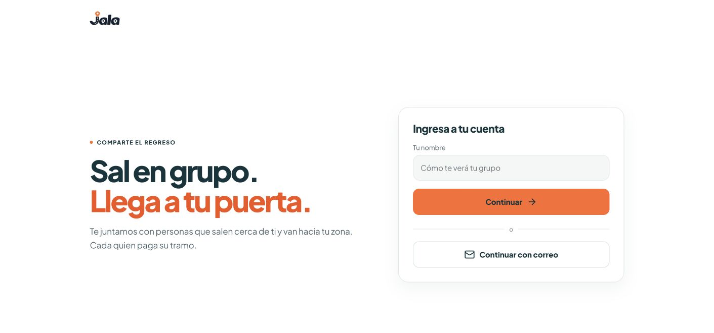
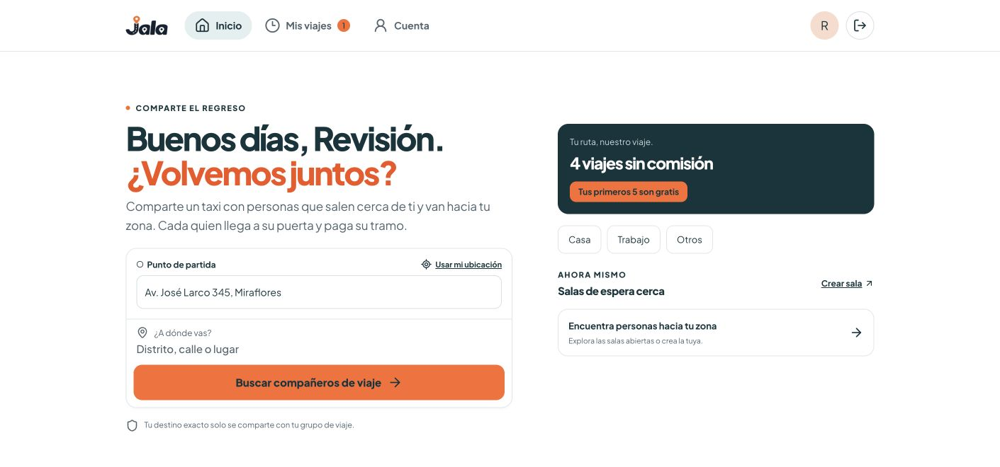
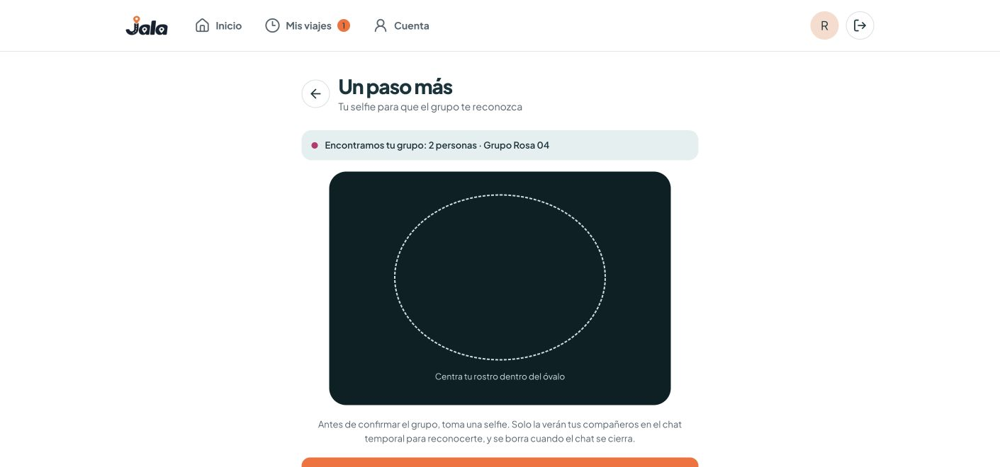
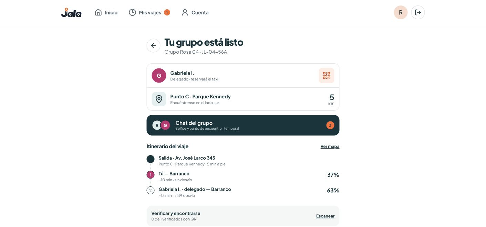
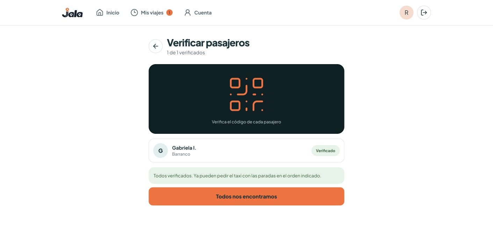
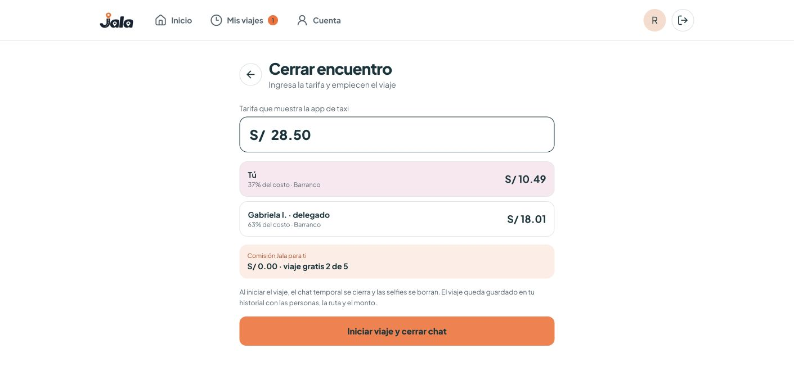
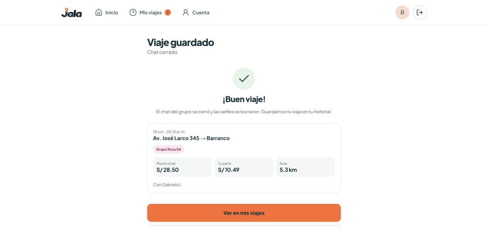
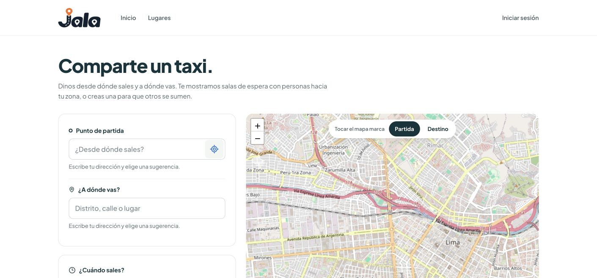

# Happy-path and real-world readiness review

Date: 2026-10-18. Source baseline: `7dcf6f2`. Verdict: **Request Changes** before an unattended real-passenger pilot.

The server-backed core is substantial and its existing tests pass. However, the primary deployed journey is a local sample, and the live flow has privacy, concurrency, abandonment, and recovery gaps. A supervised demonstration is credible if simulation is disclosed. A successful real shared taxi trip with independent passengers has not been established by this review.

## What was checked

- Walked the deployed homepage through name entry, destination, sample selfie, fixed group, code verification, fare split, and saved trip. Used fictional input and the supplied example photo; no production account, real selfie, GPS permission, booking, payment, or message was submitted.
- Followed the secondary entry into deployed `/ride`; observed an empty draft and signed-out state. Did not create production participants. Authenticated live browser steps remain unverified.
- Traced UI calls, authenticated routes, participation, road matching, persistence, group lifecycle, chat, notification scheduling, fees, and history.
- Ran ESLint and TypeScript successfully.
- Initial Vitest run: 170 passed, 49 skipped. Configured an isolated local PostgreSQL database, applied existing migrations, and started the isolated local app. Final complete run with both prerequisites enabled: **29 test files passed, 219 tests passed, zero skipped**. ESLint and TypeScript also passed after the report and reproduction were added.
- HTTP checks exercised real local auth/session cookies, face validation, creation, discovery, join, membership protection, and malformed/cross-site requests. Lifecycle integration tests use fixture routing; they do not establish real traffic estimates or taxi-provider behavior.
- Added a standalone diagnostic reproduction using fictional data and fixture routing. Its output is saved in [evidence/real-world-checks.txt](evidence/real-world-checks.txt). It changes no application logic.

## Findings, ordered by impact

### 1. P1 — The primary CTA completes a simulation rather than finding passengers

**Observed:** a made-up exact address led immediately to “Encontramos tu grupo: 2 personas · Grupo Rosa 04.” The same named companion, pickup, route distances, and code are built into the component. No visible simulation label appeared in the captured homepage or group screens. Name entry is presented as account entry but only changes React state. The apparent sign-out also only clears component state.

**Impact:** a real visitor can believe they have found companions and a meeting point although no other passenger exists. Refresh loses the active journey. The separate live account session and sample identity are unrelated.

**Evidence:** [destination submit](../../../src/components/journey/passenger-journey.tsx#L631), fixed titles/code and sample route in that component, and screenshots 01–07 below. The homepage links to `/ride` without carrying its selected origin/destination. Screenshot 08 shows that reset in practice.

**Fix:** make the primary CTA enter the real flow with its draft; keep the sample behind an explicitly labeled demo entry. Use the real account identity and session for account controls.

### 2. P1 — Public session data exposes the creator's exact destination

**Reproduced locally:** creating a pool with “Fictional private home 456” resulted in the public session repository returning that exact label and its exact coordinates. Creation copies the input destination directly into session fields. Unauthenticated session listing/detail endpoints return those fields; discovery also returns the full destination label. The leak applies to the creator's session anchor, not every passenger destination.

**Impact:** the UI promise that an exact destination is only shared with the assigned group is false for the person who creates the pool. A caller can enumerate session listings without first becoming a party member. The fallback pickup can also be the creator's exact origin.

**Evidence:** [session creation](../../../src/modules/sessions/infrastructure/participation.repository.ts#L382), [public session projection](../../../src/modules/sessions/infrastructure/session.repository.ts#L40), [public detail route](../../../src/app/api/sessions/[id]/route.ts), diagnostic `PUBLIC_EXACT_DESTINATION`.

**Fix:** publish coarse area anchors and labels, keep precise participant coordinates private, and cover list/search/detail responses with a privacy regression test. Exact locations also enter authentication redirect query strings via [draftQuery](../../../src/components/sessions/ride-request.tsx#L32); use a short-lived private draft reference rather than placing addresses in URL/history/loggable query strings.

### 3. P1 — One account can be assigned to two simultaneous taxi groups

**Reproduced locally:** two concurrent create requests for the same account both succeeded and left two waiting participations. Joining a different fictional passenger to each room and matching both rooms produced **two forming parties containing the same account**.

The reproduction held the account row briefly to force overlapping requests into the vulnerable interval. Per-session locks protect a single room; the cross-room exclusivity check happens before the account update acquires a shared lock. The member uniqueness constraint is per participation, not per live account.

**Impact:** two groups can depend on the same passenger or volunteer booker. Confirmation, credit expectations, and real pickup coordination can diverge.

**Evidence:** [claimExclusivity and call order](../../../src/modules/sessions/infrastructure/participation.repository.ts#L123), [matching commit](../../../src/modules/matching/infrastructure/matching.repository.ts#L204), [membership constraints](../../../src/db/schema/parties.ts#L91), diagnostic `waitingPoolCount:2` and `SAME_ACCOUNT_LIVE_PARTIES 2`.

**Fix:** serialize account participation changes before checking exclusivity, coordinate that rule with matching commits, and enforce a single active participation/assignment with an explicit database invariant. Add concurrent cross-room join/create/match tests.

### 4. P1 — Abandonment and a missing delegate can permanently strand a group

Forming parties have no confirmation deadline or expiry. Existing parties deliberately remain usable after the room closes. Once a trip starts, leave is rejected and only the delegate can complete it. The active-party check blocks members from joining another room.

**Real-world failure:** one person closes the app before confirming; others wait indefinitely unless someone manually dissolves the group. If the delegate starts and then disappears or loses access, passengers have no supported way to finish, cancel, or leave that active trip.

**Evidence:** [lifecycle commands and transitions](../../../src/modules/parties/domain/party-lifecycle.ts), [active-party exclusivity](../../../src/modules/sessions/infrastructure/participation.repository.ts#L123), existing lifecycle test that keeps groups usable after room expiry.

**Fix:** define confirmation and pickup deadlines, no-show recovery, delegate replacement or assisted cancellation, and auditable recovery after start. Do not simply expire a genuinely ongoing trip.

### 5. P1 — Waiting riders cannot withdraw before a match

The waiting roster offers matching and sharing but no withdraw action. `leave` resolves a party membership, so a person who is merely waiting receives `party_not_found`. Leaving the page or signing out does not release their seat. Joining another room releases it, but that is not a reasonable cancellation flow.

**Impact:** someone who changes their mind can still be assigned later, creating the no-show that blocks other riders. Volunteers cannot conveniently change their role while waiting through the visible pool UI either.

**Evidence:** [PoolView](../../../src/components/sessions/pool-view.tsx), [party lookup](../../../src/modules/parties/infrastructure/party.repository.ts#L39), [available commands](../../../src/modules/parties/domain/party-lifecycle.ts#L26).

**Fix:** add a server-backed waiting withdrawal operation, serialize it with matching, and provide visible cancel/edit controls. Consider a bounded presence/renewal policy, with clear user expectations.

### 6. P2 — The agreed fare is neither shared nor saved

The live group's fare calculator is component state on each device. Confirmation sends only an action; completion stores no taxi fare. Two members can type different totals and both “confirm the split.” Refresh clears the amount. The sample's history stores a browser-only record, separate from the live ride record.

**Impact:** percentage arithmetic is correct, but Jala cannot establish which total riders agreed to, resolve a changed quote, or show the actual charge later. External booking/payment is intentionally outside scope; agreeing on the quote still matters within a coordination product.

**Evidence:** [fareInput and confirmation UI](../../../src/components/sessions/party-view.tsx), [completion writes](../../../src/modules/parties/infrastructure/party.repository.ts#L158), [browser-only sample history](../../../src/components/journey/demo-history.ts).

**Fix:** if confirming a monetary amount is part of the promise, save a versioned shared quote, require re-confirmation after changes, and retain an accessible trip summary. Otherwise explicitly say confirmation accepts percentages only and that entered totals are private estimates.

### 7. P2 — Slow chat reads stop retrying after their own timeout

The chat aborts a read after ten seconds, then returns early from its catch handler whenever the signal is aborted. This suppresses its retry timer for a genuine timeout as well as component cleanup. Room refreshes with the same revision do not change the effect dependencies.

**Impact:** on a slow mobile connection, chat can stay at “Cargando mensajes…” or keep an old view until the room revision changes, the page remounts, or the rider sends a message. That is the communication channel needed to find companions.

**Evidence:** [chat read timeout and catch](../../../src/components/sessions/party-chat.tsx#L65). This is a source-derived issue; no network-throttled browser reproduction was performed.

**Fix:** distinguish cleanup cancellation from timeout, retry the latter with bounded backoff, and show a recoverable loading/error state. Mutation requests in `sessionApi` also have no default deadline; stalled POSTs can leave controls busy indefinitely.

### 8. P2 — Live photo retention differs from the sample privacy expectation

**Reproduced locally:** after confirm → start → complete, another party member could still retrieve the completed rider's selfie. Completion does not clear selfie data or membership, and the photo query has no party-status/retention restriction. Live chat remains readable after completion too.

**Impact:** the sample teaches that chat closes and selfies are deleted at departure; the live system retains them. No expiry/deletion mechanism was found in the reviewed paths. This is not an unauthorized outsider bypass: it is continued access by a former party member.

**Evidence:** [completion](../../../src/modules/parties/infrastructure/party.repository.ts#L158), [selfieFor](../../../src/modules/sessions/infrastructure/participation.repository.ts#L597), diagnostic `SELFIE_RETAINED_AFTER_COMPLETION true`, screenshots 03/06/07.

**Fix:** choose and disclose a single retention policy; implement deletion and access expiry consistent with it, including abandoned/cancelled groups and cache behavior.

### 9. P2 — The free-trip offer does not match live credit rules

The homepage simultaneously says four commission-free rides and “your first five are free.” The sample fare says “free trip 2 of 5.” The live implementation grants S/5 credit and debits S/0.10 for each passenger completion, with delegates waived. That covers 50 passenger fees; it is not a first-five waiver. Once credit is below S/0.10, even a would-be delegate cannot join, because everyone is checked before roles are assigned. No replenishment flow was found.

**Evidence:** [fee rules](../../../src/modules/payments/domain/fees.ts), [join credit gate](../../../src/modules/sessions/infrastructure/participation.repository.ts#L216), screenshot 02 and 06. Contrary to older status documentation, fee ledger writes are implemented now.

**Fix:** select one offer and enforce/display it consistently. Define how depleted accounts recover before promoting repeat usage.

## Journey health

| Step | Health | Evidence / remaining gap |
| --- | --- | --- |
| 1. Entry and identity | Misleading primary path | Name-only sample presented as account entry; real local auth tests pass. |
| 2. Origin, destination, departure | Partial | Sample accepts text without routing; live form exists. Sample draft does not cross into `/ride`. |
| 3. Search/create/join | Locally verified with gaps | HTTP tests pass; public destination leak and cross-room race reproduced. Public discovery API exists, but signed-out UI routes to registration before showing search results. |
| 4. Waiting and matching | Conditional | Persisted road plans and same-room serialization covered; no explicit waiting withdrawal, stalled-group recovery, or measured liquidity. |
| 5. Group and pickup coordination | Partial | Live member chat and private party access exist; slow-read retry bug. Sample has fixed companion/pickup/code. |
| 6. Confirm route and split | Partial | Shared percentages persist; monetary quote is local and unsaved; no confirmation timeout. |
| 7. External booking and start | Manual handoff | Intentional external booking; no evidence provider accepts the proposed stop order/capacity or matches the estimate. |
| 8. Complete trip | Locally verified, recovery missing | Delegate completion and fees are transactional; no passenger recovery when delegate disappears. |
| 9. History, retention, next trip | Incomplete | Sample history is local and not account-scoped; live photos persist. Rejoining the same still-open pool after completion returns `already_matched` (reproduced); a new pool can be created. |

## What works and what remains unproven

The live implementation is more than a mock: real local auth, opaque cookies, membership checks, malformed-input handling, face presence validation, persisted proposals, same-room locking, stale-snapshot checks, all-member confirmation, delegate permissions, integer fare rounding, fee ledger writes, and completed-ride counters have test evidence. Chat and Web Push are implemented; older docs calling them absent should not drive priorities.

Real-world success additionally needs enough compatible passengers and a willing booker at one departure site. The code cannot establish that supply, willingness to share, actual savings, or safe pickup. A five-minute estimated detour is based on routing estimates, not observed Lima traffic. Public routing/geocoding endpoints are configured as prototype dependencies; capacity, availability, geographic coverage, and operational fallback were not load-tested here. Notifications on Android/iOS, actual email delivery, and phone background behavior remain unverified.

The sample's “Reportar un problema” button only displays advice; it does not create a report. Real identity verification, blocking, and an operational support flow are not provided by account login or detecting a face. These are product limitations to resolve or clearly disclose before sharing with strangers.

Visible accessibility strengths include named controls, headings, status/error roles, and focus movement. Risks include long forms on phones, reliance on suggestions/map interaction, and ambiguous repeated “Elegir” labels in the sample district list. No fresh real-phone, keyboard-only, screen-reader, contrast measurement, or complete accessibility conformance test was performed; screenshots alone cannot establish compliance.

## Recommended acceptance gate

First connect the primary CTA to the live flow and fix public location exposure and cross-room exclusivity. Then add waiting withdrawal and abandoned/delegate recovery. Align monetary agreement, retention, and offer copy. Add regression checks that fail on the reproduced cases.

Before an unattended pilot, have three independently controlled phone accounts complete one consented route at a concentrated departure site. Include a late/no-show member, a disappearing delegate, app background/resume, denied GPS, slow/offline chat, routing outage, and changed taxi quote. Check that each participant can recover without database intervention. Record actual pickup success, booking stop order, fare, elapsed time, unmatched riders, and solo quotes if evaluating savings. Simulation must be explicitly labeled and excluded from these outcomes.

## Captured screens

These are current-run deployed screenshots. Saved files were inspected. Authenticated live browser steps were not captured; their evidence is local HTTP/database tests and source review.

1. Entry — renders; sample account wording is misleading.

2. Homepage — clear primary CTA; simulation and offer mismatch not disclosed.

3. Selfie/match — immediate fixed group; not evidence of live matching.

4. Group — coherent layout; fixed companion, pickup and route.

5. Verification — fixed code succeeds; no real passenger identity established.

6. Fare — sums correctly in the sample; live shared monetary agreement missing.

7. Saved trip — browser sample completes; not proof a taxi departed.

8. Live entry — renders; empty draft and separate account state after sample.

