# Happy-path readiness recheck and production logs

2026-10-18. Verdict: **Request Changes** before real passengers rely on the app unattended. A supervised demonstration is feasible if the sample is explicitly identified. No application changes or production writes were made during this review.

The browser walkthrough and initial checks used `56390b7`, which matched the production deployment inspected. During review, main advanced to `04741e3` (shared selfie camera in the live form). The review branch was rebased, that source delta was inspected, and the updated live form was opened successfully. Screenshots below record the actual capture revision; the live waiting-room capture was taken before the rebase. The backend findings are unaffected by that UI-only change.

The branch was subsequently rebased onto `4ac689a`, which shortens the waiting-room join grace from 30 to five minutes and updates its tests/docs. This does not add forming-party expiry or delegate recovery. The waiting-room screenshot predates that change and shows the former 30-minute clock. Final verification passed lint, type checking, all 219 tests with zero skipped, and a production build at `04741e3`; the post-grace-change checks are reported in the handoff.

## What was verified

- Local browser: name entry, homepage, live address suggestions, selected origin/destination on the map, sample selfie entry, sample group, fixed-code verification, fare split, saved trip, and mobile history at 390 × 844. Used public landmarks, a fictional name, and the provided example photo.
- Separate local browser: real account signup, authenticated `/ride`, fixture-photo face validation, route search, empty results, room creation, and the persisted waiting room. Signup without a `next` parameter returned to the homepage's name-only entry despite an active real session. Reloading `/ride` recognized the real account and later offered “Volver a mi sala.”
- Source: public projections, participation exclusivity, matching, lifecycle permissions, chat retries, fares, retention, API errors, logger, health checks, and CI/CD.
- Initial default test run: **170 passed, 49 skipped**. With an isolated migrated PostgreSQL database and the local app enabled, **219 passed, zero skipped**. The first full run timed out in the cold HTTP auth route at five seconds; a warmed complete rerun passed. Treat the default command's green output as incomplete integration evidence unless both test prerequisites are set.
- ESLint, type checking, and production build passed at the initial baseline. Final checks after the rebase are recorded in the handoff.
- Fresh execution of the existing diagnostic at `../2026-10-18-happy-path/evidence/real-world-checks.ts` reproduced public exact destinations, retained completed-trip selfies, two concurrent waiting participations, two live parties for one account, and `already_matched` when rejoining the completed pool. Diagnostic users/sessions were cleaned up by its `finally` block; browser fixtures remain only in the isolated local audit database.
- Automated axe checks reported zero violations for the captured mobile sample history and desktop live waiting room. This is limited evidence for two states, not accessibility certification or screen-reader testing.
- Production reads: Vercel project/deployment metadata, grouped error clusters for 24 hours, recent runtime logs, CLI production HTTP 5xx query, `/api/health`, and a public route-search request. Both production HTTP probes succeeded.

## Findings

### 1. P1 — The main passenger journey is still an undisclosed simulation

The primary search advances directly to “Encontramos tu grupo: 2 personas · Grupo Rosa 04.” The companion, pickup, route statistics and verification code are fixed. Name-only entry changes local React state; sample chat and active trip state are not server-backed. Real address suggestions and a real face-validation request do not turn the resulting group into a real match. The sample accepts the published code `JL-04-56A` as verification.

**Risk:** a visitor can believe a real companion is waiting. The polished UI makes the distinction harder to notice. Fresh screenshots 05–09 demonstrate sample completion, not passenger matching.

**Action:** connect the primary journey to authenticated live search/join/group state, or visibly label it as a sample before starting. Keep production group and verification claims out of a sample result. Source: `src/components/journey/passenger-journey.tsx` (selfie banner, fixed code, local `startTrip`).

### 2. P1 — Exact destinations are public despite the privacy promise

Fresh diagnostic output returned `Fictional private home 456` and exact coordinates through the public session repository. Creation stores the creator's exact destination in session fields; unauthenticated session list/detail endpoints return those fields. Discovery returns the destination label too. The fallback pickup can also be an exact personal origin. This finding concerns the creator's session anchor, not every participant's private destination.

**Action:** publish coarse areas separately from precise participant coordinates and test unauthenticated list/detail/search projections. Also remove exact draft addresses/coordinates from authentication redirect URLs (`draftQuery`), using private draft storage or a short-lived opaque reference. Source: `participation.repository.ts` session creation; `session.repository.ts` public projection; `ride-request.tsx` draft query.

### 3. P1 — Concurrent cross-room requests assign one account twice

Two concurrent creates both succeeded: `waitingPoolCount: 2`. After adding separate fictional passengers and matching both rooms, `SAME_ACCOUNT_LIVE_PARTIES` was **2**. The diagnostic briefly held the user row to force overlap. Session locks protect one room; `claimExclusivity` runs before the shared account update serializes these requests.

**Risk:** two groups can rely on the same passenger or booker. **Action:** acquire account-level serialization before checking/releasing participation, coordinate with matching commits, and enforce/test the account-wide invariant. Source: `participation.repository.ts:124` and the call before the user update; matching commit and membership constraints.

### 4. P1 — Waiting withdrawal and abandoned-trip recovery are missing

The live waiting room has search/share controls but no cancel-waiting operation. Party `leave` requires an existing party. Forming groups have no confirmation deadline. After start, members cannot leave and only the delegate can complete. The active-party exclusivity rule prevents another trip while that party remains live.

**Risk:** a rider who closes the app can be matched later, and a missing delegate can strand everyone. **Action:** implement waiting withdrawal serialized with matching, confirmation/no-show deadlines, and an explicit delegate-loss recovery policy. Do not automatically expire a genuinely moving trip. Source: `pool-view.tsx`, `party-lifecycle.ts`, `party.repository.ts`, active participation lookup.

### 5. P2 — Entry, account state, and drafts split across the two products

Direct signup without a return URL succeeded, then showed “Ingresa a tu cuenta” again on `/`. A subsequent `/ride` visit correctly identified the account. From the sample homepage, “Crear sala” opened an empty signed-out live form and discarded selected landmark addresses.

**Action:** make auth land in the live journey, use real identity in the homepage, and carry the selected draft into `/ride`. Screenshot 10 records the misleading post-signup entry; screenshots 13–14 show the selected draft being lost. `safeNextPath` defaults to `/`; the homepage does not consume the authenticated account state.

### 6. P2 — The total taxi quote is private component state

The live calculator holds `fareInput` locally. Confirm sends only a lifecycle action; completion stores no agreed taxi amount. Different riders can enter different totals and confirm the same group. The percentage allocation persists, but the displayed monetary agreement does not.

**Action:** persist a versioned group quote and require reconfirmation after edits, or explicitly describe the calculator as a private estimate and confirmation as acceptance of percentages only. Source: `party-view.tsx:47`, confirmation handler, `party.repository.ts` completion.

### 7. P2 — Chat stops retrying when its own ten-second read deadline fires

Source review confirms that `controller.abort()` fires after ten seconds, and the catch immediately returns for an aborted signal. That bypasses the retry timer. When the room revision stays unchanged, no new effect starts, leaving initial loading or stale messages until another trigger occurs.

**Action:** distinguish unmount cancellation from timeout and retry the latter with bounded backoff and visible recovery. Mutation calls through `sessionApi` also lack a default deadline. This is source-derived; a throttled-browser reproduction was not performed. Source: `party-chat.tsx:65–90`, `session-api.ts`.

### 8. P2 — Completed-group members retain access to selfies

Fresh diagnostic: `SELFIE_RETAINED_AFTER_COMPLETION true`. Completion does not clear the image and `selfieFor` has no lifecycle/expiry filter. This is continued access by an authorized former party member, not an outsider bypass. The sample teaches that selfies are removed when chat closes; live behavior differs.

**Action:** define and display one retention policy and implement deletion/access expiry for completed, cancelled and abandoned groups. Source: `participation.repository.ts:597`, completion writes. Screenshot 09 shows the sample's deletion claim.

### 9. P2 — Offer and repeat-trip behavior do not match the homepage

The homepage says both “4 viajes sin comisión” and “Tus primeros 5 son gratis.” Live rules grant S/5 welcome credit and charge passengers S/0.10 per completed trip; delegates are waived. That is credit for 50 passenger fees, not a first-five waiver. All joiners must afford a passenger fee before role assignment. The diagnostic also reproduced `already_matched` when rejoining the same completed pool, although a new pool can be created.

**Action:** choose one offer, align copy/rules, define depleted-credit recovery, and support or clearly explain repeat-trip behavior. Source: `fees.ts`, join credit check, participant reuse check. Do not rely on `docs/status.md`'s old counts or claim that fee-ledger writes are missing: completion does write ledger entries now.

## Production Vercel findings

**Access confirmed through both connector and CLI.** Project `jala`, ID `prj_o2JxzNFd9rnG1Mrp1AWOmIB609UV`, team `team_qFo3VtsGPLkfgjzJ2bIunLOj`. Current deployment at inspection: `dpl_3RF1J6hSNnZW5fXURWe8QCGpvqVp`, production, READY, commit `56390b7`, alias `jala.oak4.xyz`.

All times below are **UTC on 2026-10-18**. Error-cluster summaries covered 24 hours; individual runtime queries for 24 hours were rejected because the account's Hobby retention is one hour. Retried successfully with 50 minutes. The cluster endpoint does not offer an environment selector; the relevant older deployments were separately inspected and confirmed as production.

| Time | Evidence | Interpretation |
| --- | --- | --- |
| 06:13–06:16 | Seven grouped `/api/places` errors; `/places` stack explicitly says relation `places` does not exist (`42P01`). | Database/schema unavailable to earlier production code. Not a current-deployment failure. |
| 06:51–06:52 | `/ride.rsc` stack says `sessions.departs_at` does not exist (`42703`); route search also failed. | A later deployment expected a column absent in its database. |
| 09:13 | `/ride` stack says `users.credit_balance_minor` does not exist (`42703`); two `/api/auth/me` errors accompany it. | Authentication-dependent entry failed on another older production deployment. |
| 11:00–11:04 | Current deployment logged TensorFlow.js CPU-backend warnings on selfie validation, group creation, and join. | Performance warning, not proof of a failed request. Measure inference/cold-start latency before changing backend packages. |
| 11:01:28 | Current deployment: one candidate, zero parties, one unmatched. | Expected lack of compatible supply; should not be reported as a crash. |
| 11:04:14 | Current deployment: two candidates, one party, zero unmatched. | Positive evidence of production matching; does not establish booking, start or completion. |

Recent production log counts at ~11:07 UTC were five warning events and two info events. The current-deployment sample returned four TensorFlow warnings and two matching entries; counts cover a broader scope/window and should not be forced to equal that sample. The error/warning severity-filter query returned no lines despite warning events in unfiltered data; therefore warning conclusions use unfiltered records. CLI production `5xx` search over 50 minutes completed with no returned request records. No claim of a complete 24-hour request error rate is supported.

Production `/api/health` returned database up at **11:07:56 UTC**; a route-search probe returned **HTTP 200**. Current code and recent results suggest the earlier schema issues were subsequently addressed, but this review did not directly inspect the production schema or migration history. A successful `select 1` is not proof that every application column exists.

## Logs to add, in priority order

### P1: Safe error causes and request correlation

`src/lib/http.ts:66` records only `error.message`. In production this included ORM SQL plus bound parameters, including session-token hashes and precise search coordinates, while hiding the nested PostgreSQL cause that explains the failure. Server-rendered stacks exposed the missing-column cause separately.

Add a bounded, allowlisted error serializer: stable operation name, exception type, safe PostgreSQL SQLSTATE/table/column, and safe cause classification. Exclude SQL/params, authorization/cookies, tokens and hashes, emails, exact coordinates, photo data, chat bodies and reset URLs. Use safe stack frames where useful; do not serialize the whole database exception. Record request ID, method, route template, status, duration, deployment/commit and region. Return an opaque request ID with unexpected errors so support can find the corresponding record. Never log full request URLs because drafts contain private addresses.

### P1: Schema readiness and deployment evidence

Log migration start/completion/failure with revision, safe DB target identifier and duration; verify expected schema revision before promoting. CI already migrates before deploy and probes health/search/ride, but unauthenticated `/ride` does not exercise the `users.credit_balance_minor` auth query. Add a safe schema-readiness probe covering critical auth/session columns or a dedicated synthetic authenticated smoke test. Alert on schema SQLSTATEs `42P01`/`42703`, readiness failure, and elevated 5xx rates.

### P2: Journey outcomes and transition history

Add structured events after successful commits for search/create/join/withdraw, match, confirm, dissolve/start/complete, fee decision and recovery. Include opaque session/party identifiers only where needed for support; use pseudonymous actor references where possible. Record previous/next status, outcome/code, elapsed time, matching attempt, routing source/duration, candidate/group/unmatched counts, and coarse reasons such as no delegate or incompatible routes. Emit success after commit so rolled-back work is not described as completed. Do not log every unchanged room poll.

### P2: External dependencies and user-visible failures

Measure routing timeout/status/latency and selfie model-load/inference/cache-hit durations without the image, face score or image hash. Add client timeout/offline/resume and camera-denied/unsupported-format events without location/photo/message payloads, especially because geocoding runs in the browser and will not appear in server logs. Log mail provider accepted/rejected/not-configured, and push eligible-target/attempted/sent/gone/failed counts. A resolved no-provider mail call must not be counted as delivered; a push fan-out with failed > 0 needs visible warning/metric treatment rather than only an info summary.

### P2: Warning levels, alerts and retention

`logger.warn` currently writes through `console.log`; route warning output through `console.warn` and verify severity in Vercel. Preserve structured JSON and consistent event names. Add latency/error thresholds for join/match/selfie and alerts for stranded parties/long waits, with enough traffic context to distinguish no passengers from a service failure. For longer investigations, configure a supported drain or retention upgrade after selecting retention, cost and access rules; no paid service or drain was enabled during this review. See [Vercel runtime logs](https://vercel.com/docs/logs/runtime), [CLI log filters](https://vercel.com/docs/cli/logs), and [drains](https://vercel.com/docs/drains). Documentation was verified through Context7.

## Journey health and current-run screenshots

| Step | Description | Health / evidence |
| --- | --- | --- |
| 1 | Entry and real account | Real local signup succeeds; default return shows sample name entry. Screens 01, 10. |
| 2 | Origin, destination, departure and role | Real suggestions and map selection work; sample-to-live draft is lost. Screens 04, 13, 14. |
| 3 | Selfie | Example advances sample; fixture face validation worked in live form. Updated shared camera renders after rebase; real phone camera capture unverified. Screen 05. |
| 4 | Search/create/join | Authenticated route search and local room creation work; privacy and concurrency blockers reproduced. Screen 15 and integration suite. |
| 5 | Waiting and matching | Waiting room and resume work; current production logs show a successful match. No waiting withdrawal or bounded no-show recovery. Screen 15. |
| 6 | Group, chat and meetup | Sample group/verification complete; live membership/chat tests pass. Slow-read retry flaw remains; authenticated matched-party browser flow was not completed in this run. Screens 06, 07. |
| 7 | Confirm split and book | Arithmetic and lifecycle tests pass; actual quote is unshared; booking is an intentional external step. Screen 08. |
| 8 | Start/complete | Live transitions/counters/ledger pass integration tests; sample reaches saved state. No independent phone or real-taxi completion checked. Screen 09. |
| 9 | History and next ride | Sample mobile history renders; live retention and same-pool rejoin gaps remain. Screen 11 and diagnostic. |

### Captured evidence

These are fresh local captures, saved and inspected. Some viewport captures require scrolling for lower actions; the live waiting room uses a full-page capture. Screens with loading/compilation overlays were recaptured or excluded. The pre-rebase live form with gray map tiles was excluded.

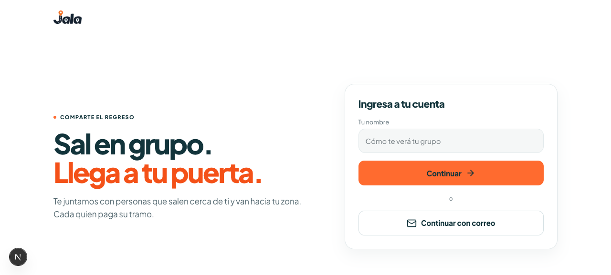

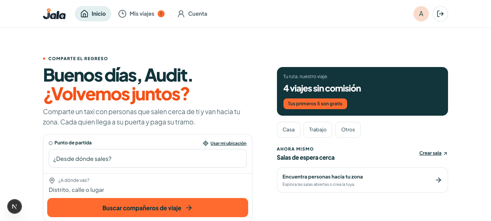

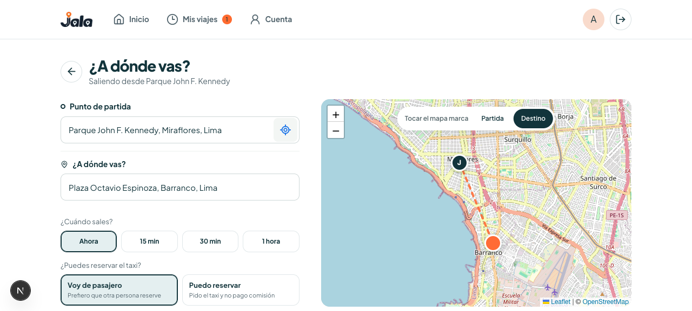

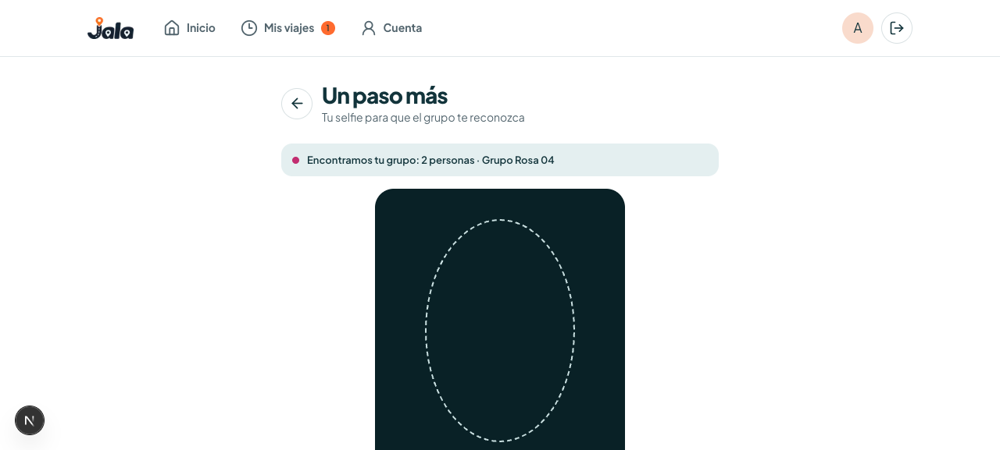

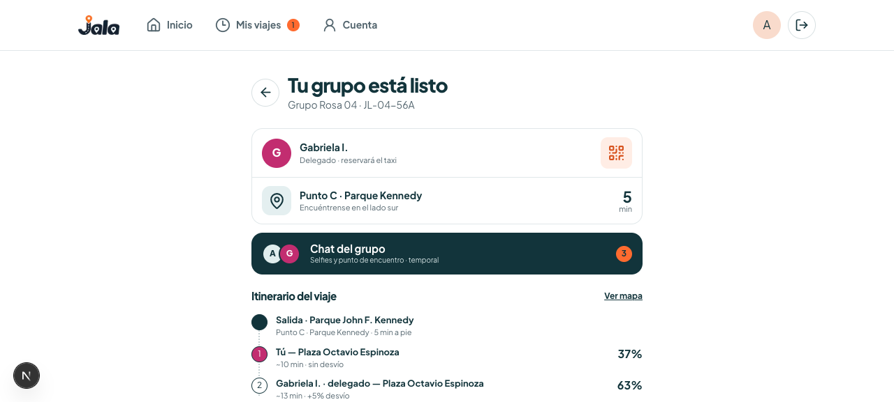

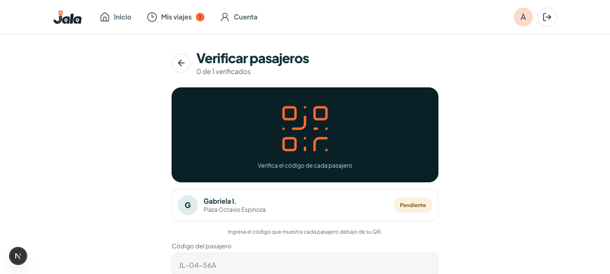

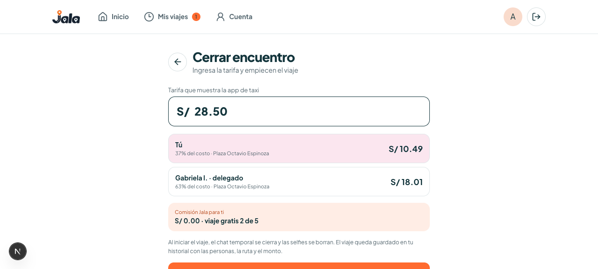

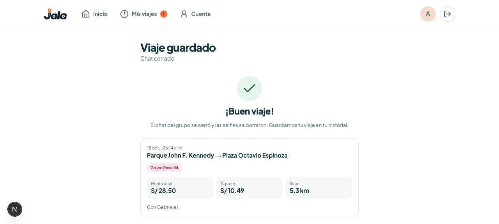

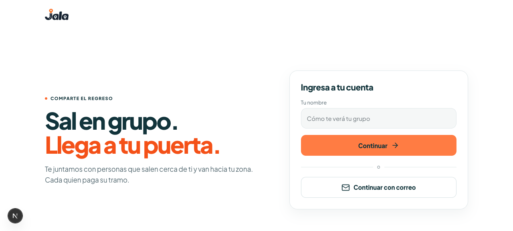

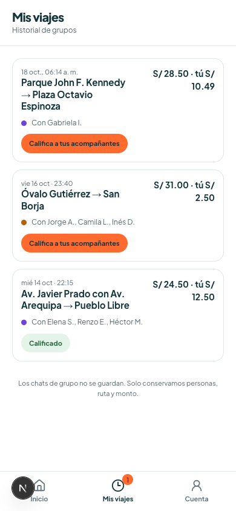

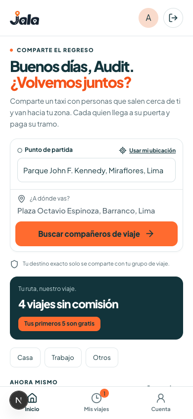

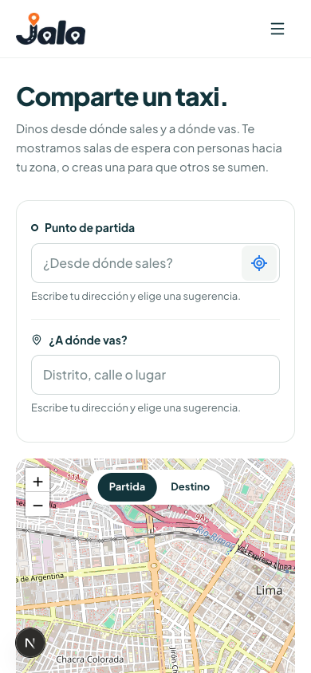

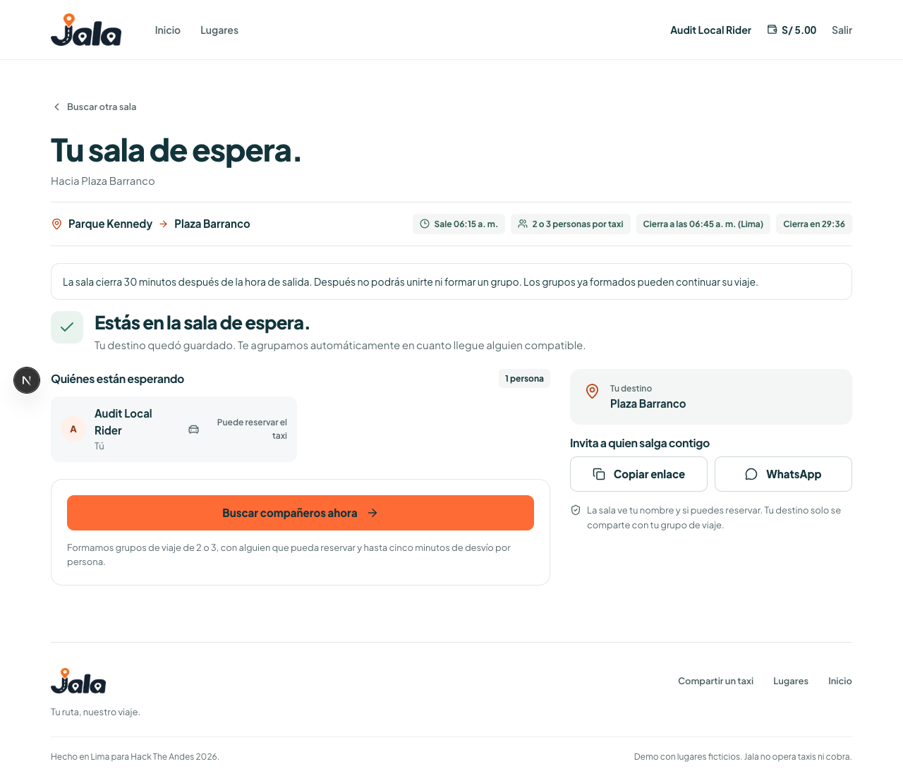

## Acceptance gate

Connect or label the primary sample; fix public location exposure and cross-room exclusivity; add waiting withdrawal and abandoned/delegate-loss recovery; align quote, offer and retention behavior. Add regression tests for the reproduced cases and safe, correlated error logging with schema readiness.

Before relying on this with strangers, have independently controlled phones complete one consented shared route, including denied GPS/camera, background/resume, slow chat, a no-show, delegate disappearance, changed quote, and a routing outage. Verify actual booking/pickup and every participant's ability to recover. Email delivery, Web Push on real Android/installed iPhone, camera formats/permissions, screen-reader navigation, real traffic estimates, load, and operational support remain unverified. Existing green tests and a successful matching log do not establish these outcomes.
